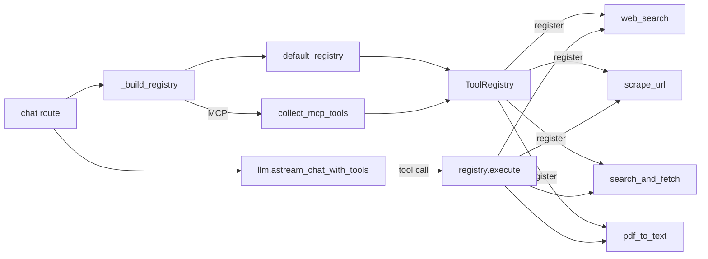
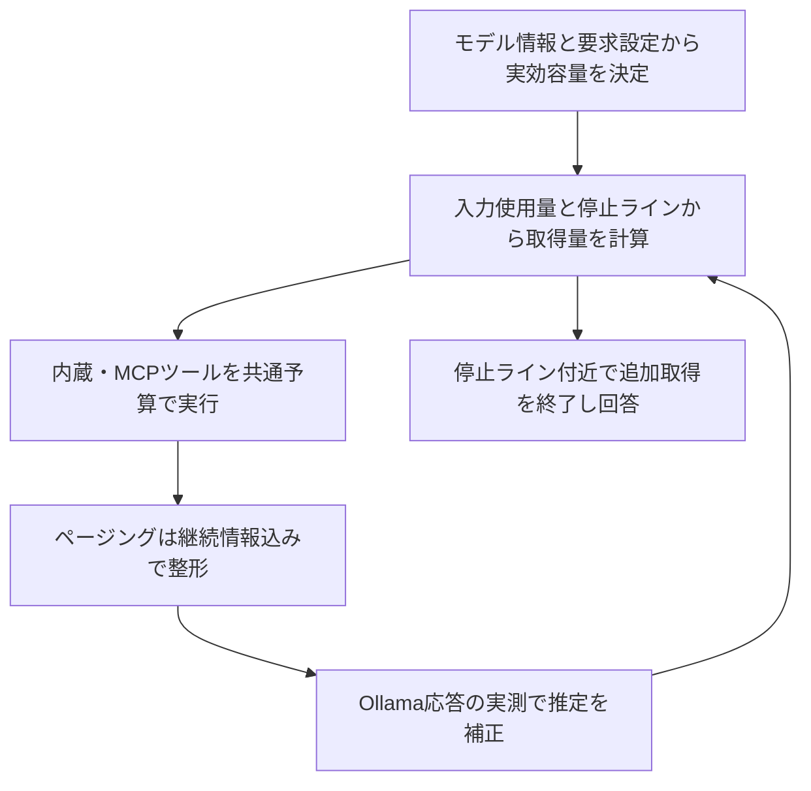
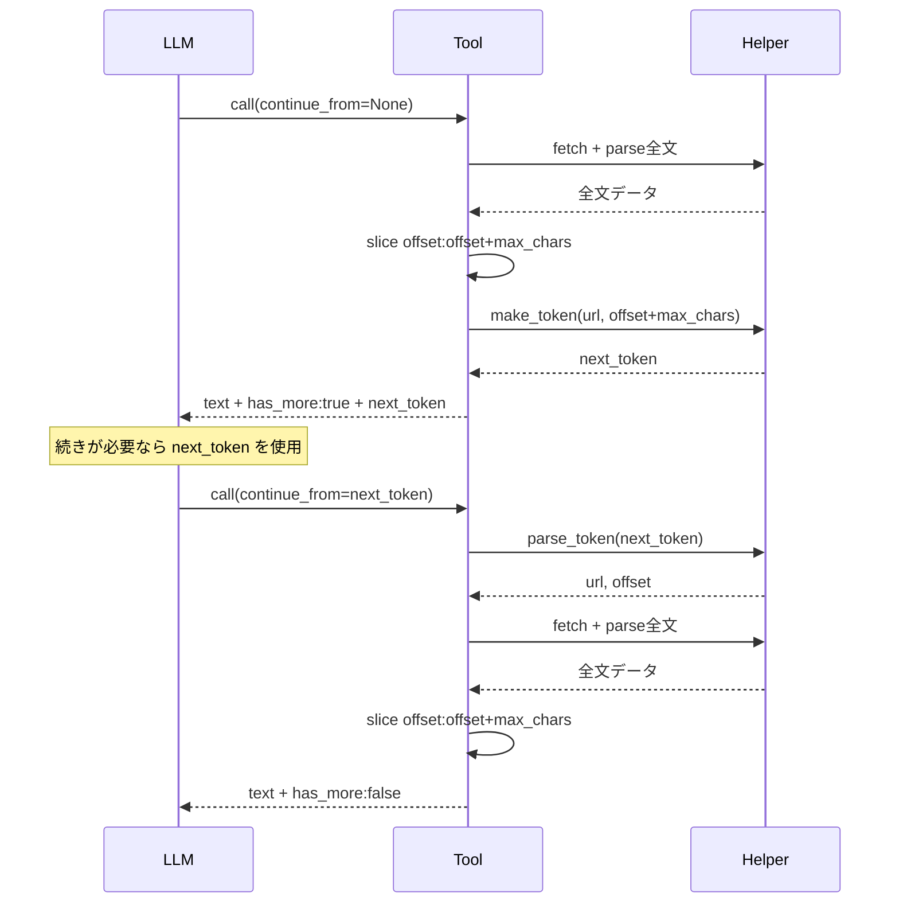

# ollama-web 標準搭載ツール スキーマ定義

本ドキュメントは `src/ollama_web/tools/` 以下に実装されている、LLM に公開される標準搭載ツールのスキーマ定義と設計状況を整理したものです。実装ベース（コード）を正として記載しています。

## 目次

- [概要](#概要)
- [ツール一覧](#ツール一覧)
- [1. web_search](#1-web_search)
- [2. scrape_url](#2-scrape_url)
- [3. pdf_to_text](#3-pdf_to_text)
- [4. search_and_fetch](#4-search_and_fetch)
- [ヘルパーモジュール](#ヘルパーモジュール)
- [レジストリと実行フロー](#レジストリと実行フロー)
- [ツール結果の切り詰め（truncation）ポリシー](#ツール結果の切り詰めtruncationポリシー)
- [ページング（継続トークン）仕様](#ページング継続トークン仕様)

---

## 概要

ollama-web は LLM（Ollama）にツール呼び出し（function calling）機能を提供するため、4つの標準ツールを組み込んでいます。各ツールは Python の callable として実装され、docstring から Ollama 互換のスキーマが推論されます。MCP 経由で外部ツールを追加することも可能ですが、本ドキュメントでは標準搭載ツールのみを扱います。

ツールの登録・実行は [`ToolRegistry`](src/ollama_web/tools/registry.py:17) が担い、チャットループ（[`llm.py`](src/ollama_web/llm.py:1)）経由で LLM から呼び出されます。

`scrape_url` / `pdf_to_text` / `search_and_fetch` は**損失なしページング（継続トークン方式）に対応**しています。本文・メタデータ・継続トークンを含む結果全体をLLM側の上限内に収めてからカーソルを確定します。`web_search` はページング対象外です。

標準ツールはすべてテキスト専用です。`web_search` は検索結果の文字列メタデータだけを返し、リンク先の画像を取得しません。`scrape_url` と `search_and_fetch` は HTTP 応答の `Content-Type` が `image/*`、`audio/*`、`video/*` の場合に拒否します。これは CSP の代替ではなく、ツール契約を揃え、バイナリを誤ってテキスト化して LLM へ渡さないためのサーバー側境界です。

## ツール一覧

| ツール名 | 実装ファイル | 概要 | ページング対応 |
|----------|--------------|------|----------------|
| `web_search` | [`search.py`](src/ollama_web/tools/search.py:1) | ddgs による複数検索元の Web 検索 | ❌ 対象外 |
| `scrape_url` | [`scrape.py`](src/ollama_web/tools/scrape.py:1) | URL のページ本文抽出 | ✅ 文字オフセット |
| `pdf_to_text` | [`pdf.py`](src/ollama_web/tools/pdf.py:1) | リモート PDF のテキスト抽出 | ✅ ページオフセット |
| `search_and_fetch` | [`fetch.py`](src/ollama_web/tools/fetch.py:1) | ファイル種別検索＋取得 | ✅ ファイル単位 |

---

## 1. web_search

- **実装**: [`web_search()`](src/ollama_web/tools/search.py:10)
- **バックエンド**: [`ddgs`](https://pypi.org/project/ddgs/) 9.16.0（ロック版）の `auto`。DuckDuckGo 専用ではなく、利用可能な検索元をライブラリが選択します。

### スキーマ

| パラメータ | 型 | 必須 | デフォルト | 説明 |
|------------|----|------|------------|------|
| `query` | `str` | ✅ | — | 検索クエリ文字列。空文字列は空リストを返す |
| `max_results` | `int \| None` | ❌ | [`settings.search_max_results`](src/ollama_web/config.py:50) (=5) | 返却件数上限。0 以下の場合はデフォルト値を使用 |

### 戻り値

`list[dict[str, str]]` — 各要素は以下のキーを持つ:

| キー | 型 | 説明 |
|------|----|------|
| `title` | `str` | 検索結果のタイトル。空・欠損・URL形式の場合は空文字。本文で補完しない |
| `href` | `str` | 結果URL（`href` が無い場合は `url` をフォールバック） |
| `body` | `str` | スニペット（`body` が無い場合は `snippet` をフォールバック） |

### 設計上の注意点

- provider の失敗はログへ記録して例外を伝播し、ツール実行層がエラー応答へ変換します。空クエリや provider が正常に空リストを返した場合とは区別します。
- region は `OLLAMA_WEB_SEARCH_REGION`（既定 `auto`）から内部選択します。かなを含む検索本文は `jp-jp`、それ以外は `us-en`。固定指定も可能です。公開スキーマには追加しません。
- backend は `auto` を維持します。検索元の認証・アクセス制限やHTML抽出不整合で取得に失敗する場合があり、今回の比較では複数backend指定による成功率向上も確認できていません。
- 構文上無効なURLと、Yahoo包装解除後を含む既知のBing広告遷移URLを除外します。残る結果の順序は保持し、除外後の不足分を埋める追加検索はしません。
- **ページング対象外**。検索結果キャッシュが必要になること、DuckDuckGo API 呼び出し回数増でアクセス制限に引っかかりやすくなる懸念から除外。

---

## 2. scrape_url

- **実装**: [`scrape_url()`](src/ollama_web/tools/scrape.py:11)
- **依存**: [`BeautifulSoup`](https://www.crummy.com/software/BeautifulSoup/)、[`fetch_public_bytes()`](src/ollama_web/tools/helper/safe_http.py:72)

### スキーマ

| パラメータ | 型 | 必須 | デフォルト | 説明 |
|------------|----|------|------------|------|
| `url` | `str` | ✅ | — | 取得対象の絶対URL。空文字列は `"Invalid URL."` を返す |
| `max_chars` | `int \| None` | ❌ | [`settings.scrape_max_chars`](src/ollama_web/config.py:49) (=4000) | 1ページあたりの返却文字数上限。0 以下の場合はデフォルト値を使用 |
| `continue_from` | `str \| None` | ❌ | `None` | 前回戻り値の `next_token`。指定時は続きのページを取得 |

### 戻り値

`str` — 1ページ分の本文テキスト。続きがある場合は末尾にページ情報フッターが付与される:

```
{本文1ページ分}

---page-info---
has_more: true
next_token: {token}
```

`has_more: false` のときは `next_token` 行が省略され、フッター自体も付与されない（短文の場合）。

### 処理フロー

1. `continue_from` があれば [`parse_token()`](src/ollama_web/tools/helper/pagination.py:1) で `(url, offset)` を復元（トークンの `url` が引数より優先）
2. [`fetch_public_bytes()`](src/ollama_web/tools/helper/safe_http.py:72) で HTML バイト列を取得（SSRF 保護・リダイレクト追跡・サイズ制限付き）
3. `Content-Type` の `charset` からエンコーディングを判定（無ければ `utf-8`）
4. BeautifulSoup で `script`/`style`/`noscript`/`template`/`head`/`nav`/`footer`/`aside` を除去
5. `article` > `main` > ルート の優先順位で本文コンテナを特定
6. 改行区切りでテキスト化し、空行を圧縮（**全文をメモリに保持**）
7. `cleaned[offset : offset + max_chars]` を切り出して返却
8. `len(cleaned) > offset + max_chars` なら `has_more: true` + `next_token`（offset=`offset + max_chars`）を付与

### 設計上の注意点

- 不正URL/ブロックURLは `Blocked URL: ...`、取得失敗は `Failed to fetch ...` のエラー文字列を返す。
- 画像・音声・動画の `Content-Type` はテキスト抽出せず拒否する。
- 不正な `continue_from` トークンは `Invalid continuation token: ...` エラーを返す。
- 全文を一度解析してメモリに保持する（`max_fetch_mb`=10MB 上限があるため実用上問題ない範囲）。

---

## 3. pdf_to_text

- **実装**: [`pdf_to_text()`](src/ollama_web/tools/pdf.py:10)
- **依存**: [`extract_pdf_page()`](src/ollama_web/tools/helper/pdf.py:12)（[`pypdf`](https://pypdf.readthedocs.io/) 使用）

### スキーマ

| パラメータ | 型 | 必須 | デフォルト | 説明 |
|------------|----|------|------------|------|
| `url_or_path` | `str \| None` | 初回のみ | `None` | 初回取得用のHTTP(S) PDF URL。チャット内では現在のセッションの `attachment:<file_id>` も利用可能。`continue_from` 指定時はトークンから復元されるため省略可能。任意のローカルパスは拒否 |
| `max_chars` | `int \| None` | ❌ | [`settings.fetch_max_chars`](src/ollama_web/config.py:52) (=8000) | 1ページあたりの返却文字数上限 |
| `continue_from` | `str \| None` | ❌ | `None` | 同じPDFの直前の戻り値にある `next_token`。PDFソースと次の開始位置を復元して続きページを取得 |

### 戻り値

`str` — 1ページ分のテキスト、またはエラーメッセージ。続きがある場合はページ情報フッターに加え、最新トークンが以前の同一PDF用トークンを置き換えること、上限到達時は最終回答へそのまま残すこと、次回は `continue_from` 単独で再開できることを示すPDF専用メタデータが付与される。このメタデータは会話言語に依存しない固定キーと真偽値で表現し、本文の連結結果には含まれない。

### 制約

- 通常は **`http://` / `https://` のみサポート**。チャット内のセッションスコープ付きラッパーだけが `attachment:<file_id>` を解決する。
- [`extract_pdf_page()`](src/ollama_web/tools/helper/pdf.py:12) 側の制約:
  - [`settings.max_fetch_mb`](src/ollama_web/config.py:53) (=10MB) 超過時は `"PDF exceeds the configured size limit."`
  - 1回あたり [`settings.max_pdf_pages`](src/ollama_web/config.py:54) (=25) ページまで処理するが、26ページ目以降は継続可能
  - `(page_index, page_char_offset)` から再開し、ページ途中の未返却文字を次回返す
  - `max_chars` は要求上限で、結果全体を動的な推定トークン予算内に収めるため本文が短くなる場合がある

### 処理フロー

1. `continue_from` があれば、`url_or_path` の有無や値にかかわらずトークンから `(url, page_index, page_char_offset)` を復元
2. PDF を全件取得・解析
3. カーソル位置から、結果全体の上限内で実際に返せる文字数だけ抽出
4. 未返却文字または残りページがあれば、その直後を指す `next_token` とPDF専用の再開指示を付与

---

## 4. search_and_fetch

- **実装**: [`search_and_fetch()`](src/ollama_web/tools/fetch.py:130)
- **依存**: [`web_search()`](src/ollama_web/tools/search.py:10)、[`fetch_public_bytes()`](src/ollama_web/tools/helper/safe_http.py:72)、[`extract_pdf_page()`](src/ollama_web/tools/helper/pdf.py:12)、[`scrape_url()`](src/ollama_web/tools/scrape.py:11)

### スキーマ

| パラメータ | 型 | 必須 | デフォルト | 説明 |
|------------|----|------|------------|------|
| `query` | `str` | ✅ | — | 検索キーワード。空文字列は `fetch.empty_query` プロンプトを返す |
| `file_type` | `str` | ✅ | — | 許可されたファイル拡張子（`pdf`/`csv`/`txt`/`md`/`json`/`html`/`htm`/`xml`/`py`/`js`/`ts`）。空文字列または許可外の値は `fetch.invalid_type` プロンプトを返す |
| `max_results` | `int \| None` | ❌ | [`settings.fetch_max_results`](src/ollama_web/config.py:51) (=3) | 取得候補URL数上限。`fetch_max_results` でキャップ |
| `max_chars` | `int \| None` | ❌ | [`settings.fetch_max_chars`](src/ollama_web/config.py:52) (=8000) | ファイルごとの1ページあたりの返却文字数上限 |
| `session_id` | `str \| None` | ❌ | `None` | 指定時、取得ファイルをセッションに永続化するためのキューに格納 |
| `continue_from` | `str \| None` | ❌ | `None` | 前回戻り値の `next_token`。指定時は候補リストを再検索せず続きを取得 |

> **注**: `session_id` は LLM から直接指定されることを想定していない内部パラメータ。チャットルート（[`routes/chat.py`](src/ollama_web/routes/chat.py:72)）が `functools.wraps` でラップし、現在のセッションID を自動注入する。

### 戻り値

`str` — 現在のファイルページのメタデータと抽出テキスト。各ファイルは以下の形式:

```
=== 候補 {idx} ===
URL: {url}
タイトル: {title}
形式: {mime}
サイズ: {size} bytes
文字数: {chars}
---
{text}
```

続きがある場合（同一ファイル内の続き、または次候補ファイル）はページ情報フッターが付与される。

### 処理フロー

1. `continue_from` があればトークンから `(候補リスト, file_idx, file_offset)` を復元（候補リストはトークンに埋め込み済み、再検索不要）
2. トークンが無い場合は従来通り検索→候補抽出
3. 現在のファイルインデックスから順に処理:
   - ファイル内で `max_chars` に達したら、そのファイルの `next_token` を生成して**そこで停止**（1回1ファイルのページ継続を優先）
   - ファイルが完了したら次のファイルへ
4. 残り候補 or 残りファイル内容があれば `has_more: true` + `next_token` を付与

> トークンペイロードは `search_and_fetch` 用に拡張され、`matched`（候補リスト）を埋め込むことで再検索なしで続きを取得（API呼び出し増加を防止）。`matched` には [`_slim_matched()`](src/ollama_web/tools/fetch.py:42) で `body`（検索スニペット）を除外した `title` / `href` のみを格納し、トークンサイズの肥大化と末尾欠損による破損を防止する。

### 設計上の注意点

- 取得失敗時は次候補へ進む `next_token` を発行し、ページングチェーンを継続。
- 不正な `continue_from` トークンは `Invalid continuation token: ...` エラーを返す。

---

## ヘルパーモジュール

### safe_http.py

- **実装**: [`safe_http.py`](src/ollama_web/tools/helper/safe_http.py:1)
- [`validate_public_http_url()`](src/ollama_web/tools/helper/safe_http.py:34): SSRF 保護。`http(s)` のみ許可、localhost/プライベートIP/メタデータIP（`169.254.169.254`）を拒否、DNS 解決後の IP も検証
- [`fetch_public_bytes()`](src/ollama_web/tools/helper/safe_http.py:72): ストリーミング取得。最大6回のリダイレクト追跡、`Content-Length` および実サイズで [`settings.max_fetch_mb`](src/ollama_web/config.py:53) (=10MB) を超える場合は拒否

### helper/pdf.py

- **実装**: [`extract_pdf_page()`](src/ollama_web/tools/helper/pdf.py:12)
- `pypdf.PdfReader` でページごとに `extract_text()`。例外ページはスキップ。
- ページ番号とページ内文字位置の複合カーソルで再開する。
- `max_pdf_pages` は1回の作業量だけを制限し、文書全体は制限しない。
- 戻り値は本文、開始・次カーソル、`has_more`、ページ警告を持つ `PageResult`。

### helper/image.py

- **実装**: [`resize_image()`](src/ollama_web/tools/helper/image.py:32)
- ビジョンモデル用の画像前処理。`max_dimension`=1024 でリサイズ、JPEG/WEBP は quality 指定。[`settings.max_image_pixels`](src/ollama_web/config.py:57) (=16M pixels) 超過時は元データを返す。LLM ツールとしては公開されていない内部ヘルパー。

### helper/pagination.py

- **実装**: [`pagination.py`](src/ollama_web/tools/helper/pagination.py:1)
- [`make_token()`](src/ollama_web/tools/helper/pagination.py:1): 継続トークン生成（`base64url(JSON)`、`ensure_ascii=True` で純ASCII化し末尾欠損時の `UnicodeDecodeError` を防止）
- [`parse_token()`](src/ollama_web/tools/helper/pagination.py:1): トークン検証・デコード。`tool` 一致・`v` バージョン・必須フィールドを検証し、不正時は `InvalidTokenError`
- [`format_paged_result()`](src/ollama_web/tools/helper/pagination.py:1): 戻り値ラッピング。`---page-info---` マーカーで本文とフッターを分離
- [`parse_paged_result()`](src/ollama_web/tools/helper/pagination.py:1): 戻り値分割（テスト・チェーニング用）

---

## レジストリと実行フロー



- [`default_registry()`](src/ollama_web/tools/registry.py:117) が4つの標準ツールを登録した [`ToolRegistry`](src/ollama_web/tools/registry.py:17) を返す
- [`ToolRegistry.ollama_tools`](src/ollama_web/tools/registry.py:63) はビルトイン callable と MCP ツール定義 dict のリストを返す（Ollama の `tools` 引数用）
- [`ToolRegistry.execute()`](src/ollama_web/tools/registry.py:78) がツール名と引数（dict または JSON 文字列）を受け取り、JSON 文字列を返す。例外時は `{"error": ...}` の JSON

---

## ツール結果の切り詰め（truncation）ポリシー

非ページング結果はLLMコンテキストへ戻す前に切り詰められる。ページング対応ツールは本文・メタデータ・トークンを含む結果全体を事前に上限内へ収め、LLM層では切り詰めない。境界違反時は本文と進行済みトークンを返さず、同じ呼び出しを再試行できるエラーにする。



固定の結果文字数制限は設けず、実効コンテキストに対する推定トークン予算を適用する。
一般設定 → ツール設定の「ツール取得の停止ライン」（初期値80%）で制御する。
会話全体の使用率を参照して追加のツール取得だけを停止する。通常回答と最終回答は拒否しない。
1回の取得量は自動調整する。
残量が1回上限未満でも縮小して実行する。容量の決定・推定・設定APIの詳細は以下を参照。

ツール実行件数とラウンド数には固定上限を設けない。
予算不足の要求には対応するtoolメッセージを残すが、実行イベントを送らない。
秘匿化・メディア通知後の結果を評価し、モデル向け画像も容量へ計上する。
単独ツール実行にはLLM向けの予算を適用しない。

停止ボタンは既存のHTTP接続を切断する。リクエスト専用ワーカーと所有するstdio子プロセスを終了し、
停止後の結果・添付を反映しない。外部Ollama/MCPサーバー内部の処理終了は保証対象外。
切断時は協調停止を要求し、1秒で終了しなければワーカーと所有する子孫を強制終了する。
保存は親プロセスに集約し、停止までに受理した途中回答だけを保存する。

`_trim_tool_result()` はページング結果が予算を超えた場合、本文・継続トークンを部分返却せず境界エラーへ置換する。非ページング結果は推定トークン予算内へ切り詰め、欠落を明示する。自動再実行はしない。

### ツール取得の停止ラインと設定

一般設定 → **ツール設定**の「ツール取得の停止ライン」は初期値80%。
履歴・指示・ツール定義・取得資料などを含む入力の使用率を参照し、停止する対象は追加のツール取得だけとする。
最初から停止ラインに達している場合はツールを提供せず、通常回答を生成する。
通常回答と取得停止後の最終回答を、この設定を理由に拒否しない。
セッション全体の保存量や通算トークン数に上限を設けるものではない。

`GET /api/settings`と`PUT /api/settings`では、次の設定を読み書きする。
値は0より大きく1未満の有限数。画面では1〜99%のスライダー1項目として表示し、Ollama設定には配置しない。

```json
{
  "tools": {
    "context_usage_limit": 0.8
  }
}
```

各設定画面はその画面の項目だけを更新する。ツール設定の保存で、Ollamaオプション・
カスタムプロンプト・表示言語・他画面の未保存入力を変更しない。
旧`tool_budget`は以前の回答予約を残す停止ラインへ読み替える（既定の回答予約20%は停止ライン80%）。
以前の累積割合・1回割合・安全余白は使用しない。新しい`tools`があれば優先し、通常保存時に旧形式を取り除く。

### 実効容量と使用量の推定

| 条件 | 取得に使う実効コンテキスト容量 |
|---|---|
| ローカル | `/api/show`のモデル容量と要求`num_ctx`の小さい方。片方だけ判明していればその値 |
| ローカルの初回応答後 | `/api/ps`で同じモデルの割り当て容量を確認できれば、縮小方向にだけ補正 |
| Cloud | `/api/show`のモデル容量。要求`num_ctx`で縮小しない |
| モデル情報の取得失敗・欠落 | 正の要求`num_ctx`。それも不明なら8192トークンの推定値 |

モデル容量は`model_info.general.architecture`に対応する`<architecture>.context_length`を使う。
Cloudはリモート情報またはCloudモデル名で判定し、古いSDKでもリモート情報を保持する。
能力情報と容量情報は同じモデル情報をリクエスト内で再利用する。

テキストはUTF-8バイト数÷2の切り上げを初期推定とし、メッセージ形式・ツール定義・引数も計上する。
画像は初期値として1枚4096トークンを予約する。Ollamaの`prompt_eval_count`が送信前の推定を超えた場合、
補正係数を引き上げる。最新の実測入力・生成量・追加結果も次の入力推定の下限とし、
過去ラウンドの入力数を累積加算したり、取得済み結果を二重に差し引いたりしない。
推定は厳密なトークン数やコンテキスト適合を保証しない。

1回の取得量はモデル容量と現在の残量から自動調整し、通知・継続情報・最終回答指示の余白を確保する。
正の`num_predict`が多くの回答容量を必要とする場合も、調整するのはツール取得量だけである。
`num_ctx`や`num_predict`自体は変更しない。画像が収まらない場合もユーザー向け成果物は保持し、
モデルには省略を通知する。添付プレビュー・HTTP取得サイズなど、別目的の制限は独立して維持する。

### 表示・イベント・検証

PC・スマホ共通の円形ゲージにコンテキスト使用率を%で表示し、クリック・タップで使用量・
ツール取得の停止ライン・モデル容量を確認できる。これは直近の入力使用量であり、セッションの通算使用量ではない。
処理中の推定値とOllamaの実測値を区別する。履歴の自動要約・削除や調査の保存・再開は行わない。

`context_budget`イベントと`done.context_budget`には`context_usage_limit`、`input_limit`、
`input_tokens`、`effective_context`、`stop_reason`などを含める。
`input_limit`はツール取得判定用であり、通常回答の入力上限ではない。
`tool_limit`は互換性のための別名で、独立したツール累積上限としては使用しない。
`done.num_ctx`は実効容量、`requested_num_ctx`は要求値とし、最終状態をセッションに保存する。旧セッションも読み込める。

表示用の計算は停止状態を変更せず、実際にツールを停止した場合だけ停止理由を設定する。
停止ラインによる取得終了と、継続情報の容量不足を区別し、Ollama自身の容量不足・通信・推論エラーは通常どおり通知する。
ログには容量の根拠・推定と実測・補正・停止理由を残し、本文や秘密情報を追加記録しない。

検証では、停止ライン直前・ちょうど・超過でのツール提供、停止後の最終回答、通常回答への非適用、
ページ連結による原文復元、旧設定の移行、同時実行の分離を確認する。
関連テストは[予算管理](../tests/test_context_budget.py)、[ツールループ](../tests/test_llm.py)、
[ページング](../tests/test_tools.py)、[ブラウザ操作](../tests/test_chat_ui.py)にある。
実モデルの確認にはユーザーの会話・添付ではなく合成入力を使い、停止ラインを低くした状態でも
通常回答が生成されることと、追加取得が実行されないことを分けて確認する。

---

## ページング（継続トークン）仕様

### 設計方針

- **不透明な継続トークン**（`base64url(JSON)`）を採用。LLMは値を解釈せずコピペするだけ
- 数値 `offset`/`page` は使わない → 「0始まりか1始まりか」「前回値の記憶」の推論負荷を排除
- 状態はトークン自体にエンコード → **ステートレス**。seed変動でも「直前のツール結果の `next_token` を渡す」だけで動く
- サーバー側キャッシュ不要（トークン = 状態）

### トークンペイロード構造

```json
{
  "v": 2,
  "tool": "scrape_url",
  "url": "https://example.com/page",
  "offset": 4000
}
```

`search_and_fetch` は追加フィールドを埋め込む。`matched` には検索スニペット（`body`）を含めず `title` / `href` のみを格納する（[`_slim_matched()`](src/ollama_web/tools/fetch.py:42) で生成）。これによりトークンサイズを数百バイトに抑え、LLM が `continue_from` にコピーする際の末尾欠損による破損を防止する:

```json
{
  "v": 2,
  "tool": "search_and_fetch",
  "url": "https://example.com/file.pdf",
  "offset": 8000,
  "matched": [{"title": "...", "href": "..."}],
  "file_idx": 1,
  "file_offset": 8000,
  "pdf_page_index": 3,
  "pdf_page_char_offset": 1200,
  "file_type": "pdf"
}
```

### 戻り値形式

```
{本文}

---page-info---
has_more: true
next_token: {token}
```

- `has_more: false` のときは `next_token` 行を省略（フッター自体も付与しない）
- 正常なページング結果全体が上限内に収まるため、`---page-info---` を含む結果は切り詰め対象外

### LLM誤用対策

- **不透明トークン**: 推測補完が不要 → seed 変更でもばらつきにくい
- **直感的なオプション名**: `continue_from`（「続きを取得する」という意図が明確）
- **システムプロンプトで明示**: [`prompts/ja.json`](src/ollama_web/prompts/ja.json) / [`en.json`](src/ollama_web/prompts/en.json) の `tool_system` に使い方を記載
- **捏造対策**: `parse_token()` で JSON 構造・`tool` 一致・`v` 検証。捏造トークンは `InvalidTokenError` → エラーメッセージ返却
- **退化しない**: `continue_from` 未指定時は従来動作（先頭から取得）

### 設定項目

| 項目 | デフォルト | 説明 |
|------|------------|------|
| `tools.context_usage_limit` | 0.8（80%） | ツール追加取得の停止目安。通常回答には適用しない。一般設定 → ツール設定で変更可能 |
| [`pagination_token_ttl`](src/ollama_web/config.py:59) | 1800 (秒) | トークン有効期限（将来のキャッシュ無効化用、現状は検証のみ） |

### ページング全体フロー


